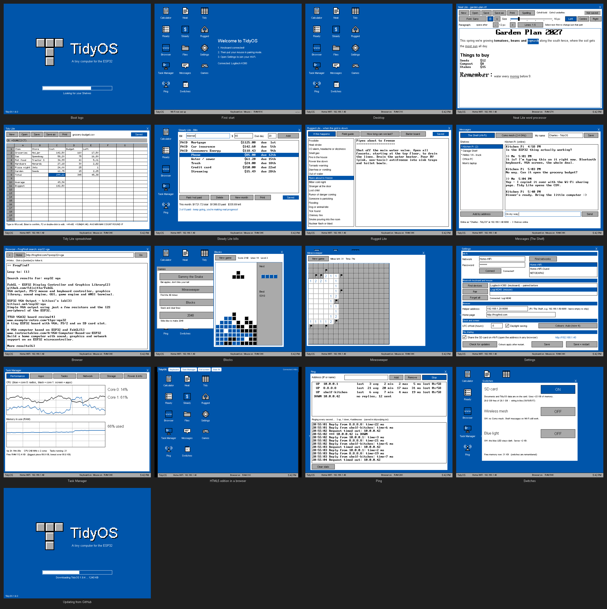
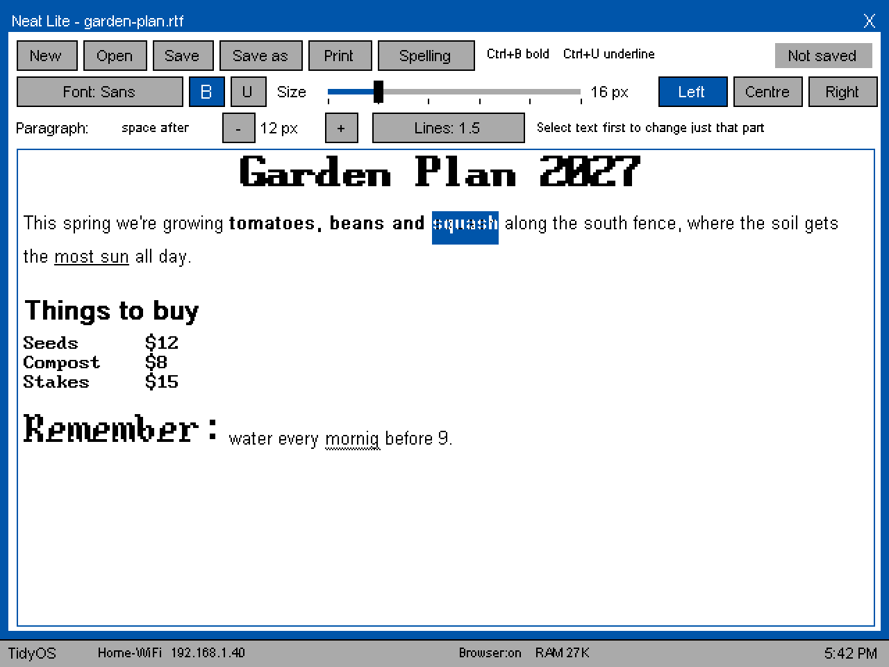
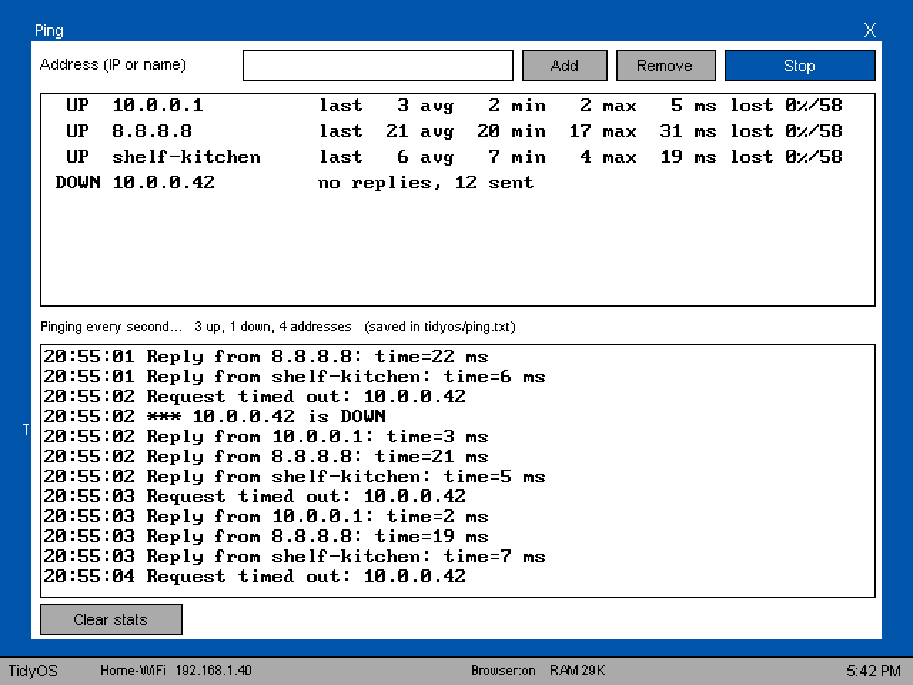
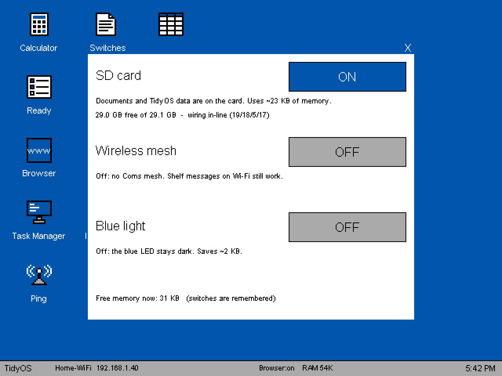
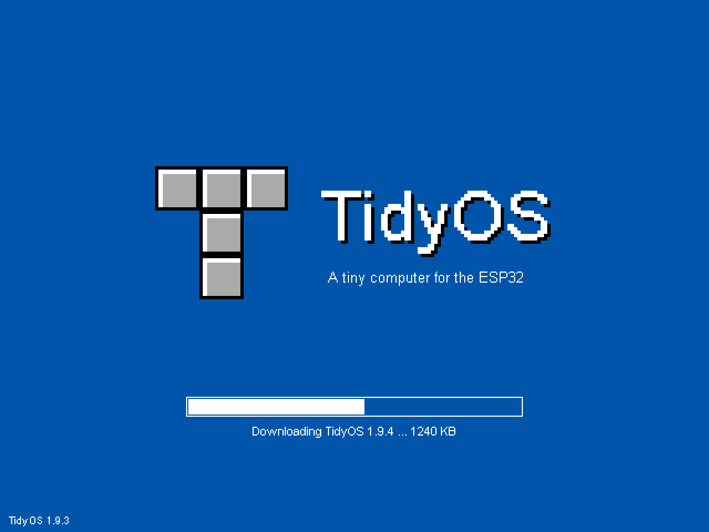
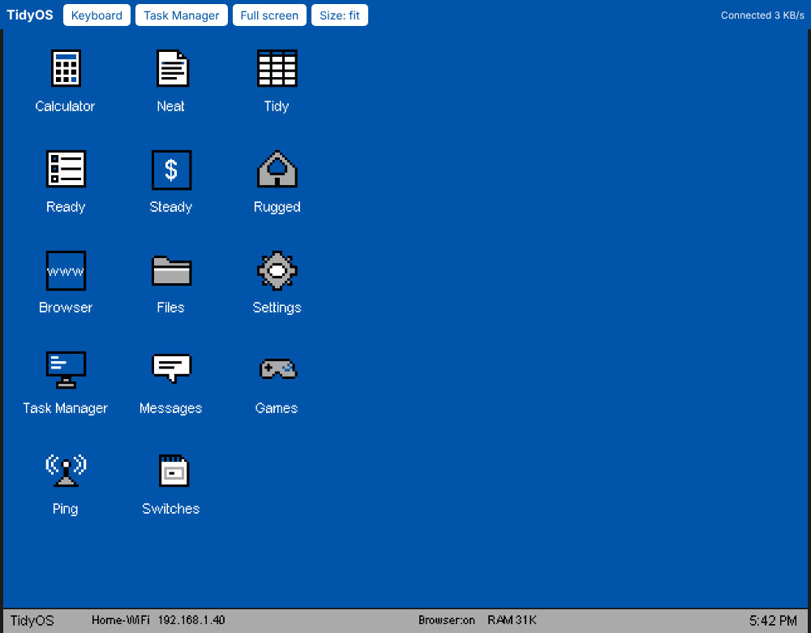
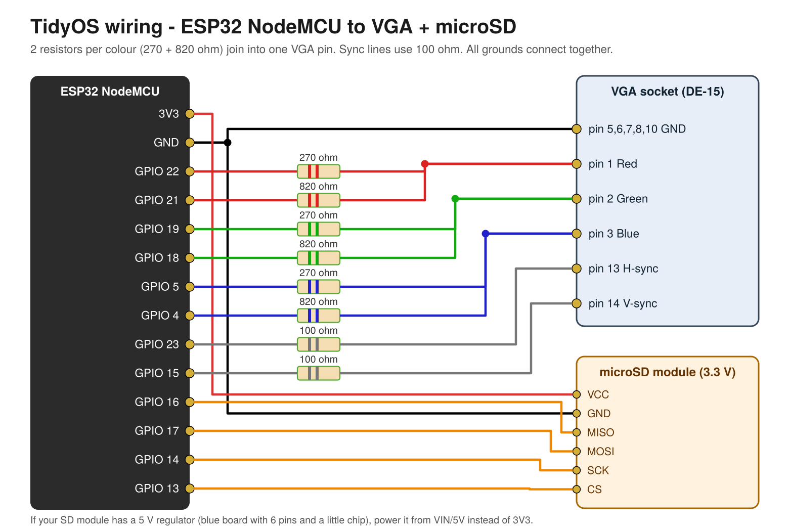

# TidyOS for ESP32

**One-click install: https://hardwaremack-prog.github.io/TidyOS-ESP32/** (Chrome or Edge)

A tiny general-purpose computer on a NodeMCU ESP32:

- **Two editions, picked with a switch on the flasher:**
  - **VGA:** a 640 × 480 desktop on a VGA monitor (8 or 4 colours, picked automatically to fit in RAM) with a Bluetooth keyboard and mouse
  - **HTML5:** the same desktop in a web browser on any phone, tablet or PC on your Wi-Fi. No monitor or resistors; the browser is the keyboard and mouse
- **Bluetooth keyboard and mouse** (Bluetooth LE, VGA edition)
- **microSD card** for your files (falls back to internal flash with no card)
- **Wi-Fi** with a clock that sets itself from the internet
- Apps: **Calculator, Neat Lite** (writing, with spell check), **Tidy Lite** (spreadsheet), **Ready Lite** (to-do), **Steady Lite** (bills), **Rugged Lite** (grid-down guide), **Messages, Browser, Files, Settings, Task Manager, Ping, Switches**
- **Printing** to network printers (found automatically), through a Pi with CUPS, or Save as PDF
- **Messages** with The Shelf: chat with every Shelf on your Wi-Fi, and join the Shelf boards' 2.4 GHz Coms mesh
- **Wi-Fi file sharing** (like Shelf Lite): one switch turns on a web page for copying files to and from the SD card
- **Games:** Sammy the Snake, Minesweeper, Blocks and 2048
- **Task Manager** (Ctrl+Shift+Esc): live CPU graphs for both cores, RAM, open apps, every FreeRTOS task, network, storage and power

> Status: version 2.0.5. It compiles cleanly against the pinned library versions, but it has **not been tested on real hardware yet**.
> If something misbehaves, open the Serial Monitor at 115200 to see the start-up log.

---

## What it looks like



*These are drawn previews made from TidyOS's own layouts, 4-colour palette and FabGL fonts, not photos of a running board. The real screen should look very close.*

### What's new

| | |
|---|---|
|  | **Neat Lite word processor** – fonts, a size slider for any word, bold, underline, alignment, paragraph spacing, spell check; saves .rtf. *The text area is drawn by Neat's real layout code with FabGL's fonts.* |
|  | **Ping** – keep pinging a saved list of addresses until you press Stop, with up/down, times and loss for each. |
|  | **Switches** – SD card, wireless mesh and blue light on/off to save memory. |
|  | **Updating from GitHub** – Settings → Check for updates downloads and installs a new version by itself. |
|  | **HTML5 edition** – the whole desktop in a web browser on any phone or PC. |

## HTML5 edition (desktop in your web browser)


*Drawn desktop, real browser page: this is the HTML5 page running against a simulated board.*

1. On the flasher page, flip the switch to **HTML5** and click **Install TidyOS (HTML5)**. The only wiring you need is the optional microSD module.
2. Power the board. On a phone or PC, join the Wi-Fi hotspot **TidyOS-Setup** (password `tidyos123`). The desktop pops up, or open **http://192.168.4.1**.
3. Open **Settings**, join your home Wi-Fi, **Save**.
4. Back on your home Wi-Fi, open **http://tidyos.local** (or the address at the bottom of the desktop).

No luck with the hotspot? With the board plugged into a computer, open a serial monitor at 115200 and type `!wifi Your network name|your password` then Enter. `!status` shows the address to open.

How it works: TidyOS still draws into its normal 640 × 480 screen memory. A small web server on port 80 sends only the rows that changed to the browser over a WebSocket (about 20 updates a second), and the browser sends keys, clicks, wheel and touches back. A phone's on-screen keyboard works through the **Keyboard** button in the top bar.

- One browser at a time. Opening TidyOS somewhere else takes over and the first tab says so.
- Bluetooth is switched off in this edition. That frees roughly 60 KB of RAM, so it normally gets 8 colours.
- If it can't join your Wi-Fi within 25 seconds, the TidyOS-Setup hotspot comes back. It turns itself off 2 minutes after TidyOS is on your home Wi-Fi.
- Wi-Fi file sharing moves to port **8081** (`http://tidyos.local:8081`), because port 80 shows the desktop.
- No VGA pins are driven in this edition, so the microSD module can use the **in-line wiring** from The Shelf: plugged straight onto GND · 19 · 18 · 5 · 17 (MISO 19, CLK 18, MOSI 5, CS 17), with its 3v3 pin bent up and one jumper to 3V3. The classic wiring (16/17/14/13) works too; TidyOS tries both. Task Manager → Storage shows which one it found.
- The browser page scales the screen with whole pixels and then smooths it slightly, so text stays even at any window size. **Size** switches to exact 1:1 pixels.

## Switches (save memory)

The **Switches** icon has three on/off switches. All are **off by default** because the ESP32 is short of RAM, and each is remembered after a restart:

| Switch | When on | Memory |
|---|---|---|
| SD card | Documents and TidyOS data live on the microSD card. Off: they go to internal flash (about 1 MB); files on the card stay there | ~23 KB |
| Wireless mesh | The Coms 2.4 GHz mesh with Shelf boards nearby. Shelf messages over Wi-Fi work either way | a few KB |
| Blue light | The status light below | ~2 KB |

## The blue status light

When switched on (Switches), the blue LED on the NodeMCU (GPIO 2) shows what TidyOS is doing. The red one is the power light.

| Blue LED | Means |
|---|---|
| Slow blink | Starting up |
| Breathing (slow fade in and out) | Ready |
| Quick flicker | The microSD card is being read or written |
| Fast flash | Low on memory: close an app |

## Updating from inside TidyOS

**Settings → Check for updates.** TidyOS restarts into a lean update mode, checks this repo's web-flasher manifest, and if there's a newer version it downloads it to the **SD card** (HTTPS, certificate-checked, SHA-256 verified). It then restarts into a small **update loader**, which checks the file again, installs it and starts the new TidyOS. It takes about 2 minutes. Your Wi-Fi, settings and files stay.

- Needs Wi-Fi and the microSD card in the board (TidyOS switches the card on just for the update).
- The loader lives in its own flash slot, so a board needs **one install from the web flasher** (1.8 or later) before in-app updates work.
- If anything goes wrong (no Wi-Fi, no card, a damaged download), nothing is changed and TidyOS starts as before.

Flash layout (4 MB): TidyOS app 0x10000 (2.9 MB) · update loader 0x300000 (384 KB) · internal storage 0x360000 (576 KB).

## If it crashes

TidyOS records the crash just before the restart. **Task Manager → Power & info** shows it under *Last crash* (reason, free memory and a list of addresses), and it's added to `tidyos/crash.txt`. A photo of that screen is enough to find the line of code: the matching debug file for the current version is in `debug/`.

## 1. Parts

| Part | Notes |
|---|---|
| NodeMCU ESP32 (ESP32-WROOM-32, 4 MB flash) | NodeMCU-32S or ESP32 DevKitC. Not a WROVER board, because GPIO 16/17 are used for the SD card. |
| VGA socket (DE-15 female) | A breakout board with screw terminals is easiest |
| Resistors | 3 × 270 Ω, 3 × 820 Ω (800 Ω is also fine), 2 × 100 Ω |
| microSD module + card | A 3.3 V SPI module. Cards up to 32 GB, formatted FAT32 |
| Bluetooth **LE** keyboard and mouse | Most keyboards and mice from the last ~8 years work, including multi-device ones. Very old "Bluetooth 3.0 only" models won't show up. |
| VGA monitor | Must accept 640×480 at 60 Hz (nearly all do) |

## 2. Wiring



| ESP32 pin | Through | Goes to |
|---|---|---|
| GPIO 22 | 270 Ω | VGA pin 1 (red) |
| GPIO 21 | 820 Ω | VGA pin 1 (red) |
| GPIO 19 | 270 Ω | VGA pin 2 (green) |
| GPIO 18 | 820 Ω | VGA pin 2 (green) |
| GPIO 5  | 270 Ω | VGA pin 3 (blue) |
| GPIO 4  | 820 Ω | VGA pin 3 (blue) |
| GPIO 23 | 100 Ω | VGA pin 13 (H-sync) |
| GPIO 15 | 100 Ω | VGA pin 14 (V-sync) |
| GND | – | VGA pins 5, 6, 7, 8, 10 |
| GPIO 16 | – | SD MISO |
| GPIO 17 | – | SD MOSI |
| GPIO 14 | – | SD SCK / CLK |
| GPIO 13 | – | SD CS |
| 3V3 (or VIN for 5 V modules) | – | SD VCC |
| GND | – | SD GND |

This is the same VGA pinout as the LilyGO "FabGL VGA32" board, so TidyOS also runs on that board unchanged.

## 3. Flash it (no tools needed)

1. Plug the NodeMCU into your computer with USB.
2. In **Chrome or Edge**, open **https://hardwaremack-prog.github.io/TidyOS-ESP32/** and click **Install TidyOS**.
3. Pick the ESP32's port. When updating, leave **Erase device** unticked to keep your Wi-Fi and settings. If it won't connect: hold **BOOT**, tap **EN**, let go of **BOOT**. The board then waits in install mode as long as you need. (A 10 µF capacitor from EN to GND usually makes this automatic.)
4. Press **EN/RST** when it finishes.

Manual alternative: in https://espressif.github.io/esptool-js/ flash `firmware/TidyOS-ESP32-full.bin` (VGA) or `firmware/TidyOS-ESP32-HTML5-full.bin` (HTML5) at address **0x0**.

## 4. First start (VGA edition)

1. TidyOS shows the desktop with a welcome note.
2. **Put your Bluetooth keyboard in pairing mode.** Until a keyboard is connected, TidyOS accepts any keyboard or mouse it finds in pairing mode, so you're never stuck.
3. **Put your mouse in pairing mode** next. (You can also add devices later in Settings → Find devices → Pair.)
4. Open **Settings** → *Find networks* → pick your network → type the password → **Connect** → **Save**.
5. Set your UTC offset under Settings → Clock (Michigan is −5, with Daylight saving ticked).

Paired devices reconnect by themselves on the next power-up.
No Bluetooth yet? Typing in the Arduino Serial Monitor (115200 baud) also works as a keyboard.

## 5. The apps

| App | What it does | Where files go |
|---|---|---|
| Calculator | Four-function with %, +/−. Works from the keyboard too | – |
| **Neat Lite** | Text editor with live spell check (dotted underline) and a Spelling button that offers suggestions. Ctrl+S save, Ctrl+O open, Ctrl+N new, Ctrl+P print. Saved light | `/SD/Documents/*.txt` |
| **Tidy Lite** | 26 × 200 spreadsheet. Formulas: `=A1+B2*3`, `SUM AVG MIN MAX COUNT ROUND IF ABS SQRT INT`, ranges like `A1:A9` | `.csv` (opens in the full Tidy, Excel, etc.) |
| **Ready Lite** | To-do list with done/undo and a progress count. Saves automatically | `/SD/tidyos/ready.txt` |
| **Steady Lite** | Monthly bills: amount, due day, paid. Shows total, paid and left, plus encouragement. "New month" resets paid flags | `/SD/tidyos/steady.csv` |
| Messages | Chat with The Shelf on your PCs and Pis, and with Shelf boards, over Wi-Fi. Second tab: the Shelf boards' 2.4 GHz Coms mesh | `/SD/tidyos/msg-*.txt` |
| **Rugged Lite** | The Rugged app's offline guide for when the grid is down. **If this happens:** 33 emergency cards (bleeding, CPR, CO, pipes freezing, tornado...). **Field guide:** 60 topics in 11 groups, with search. **How long can we last?:** water, food, firewood and fuel in days, flagging anything under a week. **Barter board:** have / need / trades made. All of it can be printed | `/SD/tidyos/rugged.txt` |
| Browser | Text web browser with numbered links. Click a `[number]` or type it in the address box. Backspace = back | – |
| Files | Browse the SD card. Open, new folder, rename, delete. **Wi-Fi sharing** button | – |
| Games | Sammy the Snake (arrow keys), Minesweeper (click, right-click to flag), Blocks (falling blocks: arrows, Up turns, Space drops, P pauses), 2048 (arrow keys). Best scores are kept | – |
| Settings | Wi-Fi, Bluetooth, browser helper, clock, screen colours | saved in ESP32 flash |
| Ping | Saved list of IP addresses or names. **Start** pings every one about once a second until **Stop**: up/down, last, average, min, max and loss for each, plus a running log like `ping -t`. A target counts as down after 2 misses in a row. List saved in `tidyos/ping.txt` | – |
| Task Manager | Live CPU (per core) and RAM graphs, open apps (switch / end task), all FreeRTOS tasks with core, priority and stack left, network (signal, IP, router ping, traffic, Shelves, mesh, Bluetooth), storage (SD, flash, settings, RAM), power estimate, chip temperature, last reset reason. Open with Ctrl+Shift+Esc or Ctrl+Alt+Del | – |

## 6. Printing

Neat, Tidy, Ready and Steady all have a **Print** button.

- **Network printer:** click *Find printers* and pick yours (it finds AirPrint / IPP printers on your Wi-Fi), or type its IP address. TidyOS sends a PDF, and if the printer doesn't take PDFs, it sends page images (PWG raster) instead. Most printers made since about 2015 accept one or the other.
- **Through the Pi helper:** if the helper (below) runs on a Pi that has CUPS with your printer added (`sudo apt install cups`), pick *Through the Pi helper*. Any printer the Pi can use will work.
- **Save as PDF:** writes `Documents/<name>.pdf` to the SD card.

## 7. Wi-Fi file sharing

Turn on **Wi-Fi sharing** in Files (or *File sharing* in Settings). Then open the address it shows (like `http://192.168.1.40`, or `http://tidyos.local`) in any browser on the same Wi-Fi: phone, PC or Pi.
- Browse folders, download files, upload many files at once (button or drag and drop), make folders, rename and delete.
- Uploads go straight to the SD card in small pieces, so big files are fine.
- It stays off until you switch it on, and TidyOS remembers your choice after a restart.
- Anyone on your Wi-Fi can reach it while it's on, so switch it off when you're done.

## 8. Spell check

Neat underlines words it doesn't know as you type, using a built-in ~78,000-word English dictionary. **Spelling** steps through each word and offers *Change*, *Ignore* or *Add to dictionary*. Words you add are kept in `/SD/tidyos/mywords.txt`.

## 9. Messages and The Shelf

**The Shelf (Wi-Fi):** TidyOS speaks The Shelf's messaging protocol (presence on UDP 41234, HTTP on port 8080).
- It shows up in the Messages list of every Shelf on your network: the PC/Pi version and the Heltec/ESP32 boards.
- You can chat one-to-one with any of them.
- If a Shelf doesn't appear on its own, use *Add by address*.
- Pictures sent from a Shelf show as "[picture]".

**Coms mesh (2.4 GHz):** TidyOS joins the Shelf boards' ESP-NOW mesh as a full member.
- It does room-style chat, relays messages for others and sends "received" receipts.
- It asks for the last 12 hours of messages when it meets a board.
- ESP-NOW only hears boards on the same Wi-Fi channel. Boards running their own Wi-Fi use channel 1; boards on your home Wi-Fi use its channel.
- With no LoRa radio, it doesn't hear the 900 MHz side directly; a Heltec board carries messages between the two.

## 10. Browser: two ways to use it

**On its own:** plain `http://` sites load directly. Secure `https://` sites and searches go through
[FrogFind](http://frogfind.com), a free service that turns modern pages into simple HTML for old computers.

**With the helper (recommended):** run `helper/tidyos_proxy.py` on your Pi or The Shelf.
It does the https, decompression and HTML cleanup, so the ESP32 just shows text. It needs only Python 3, with nothing to install.

```bash
python3 tidyos_proxy.py            # prints the address to type into TidyOS
python3 tidyos_proxy.py --printer Office_Laser   # pick a CUPS printer for TidyOS printouts
```

Then in TidyOS: **Settings → Browser → Helper address** = `192.168.x.x:8088` → Save.
With the helper running, searches use DuckDuckGo.

To start it automatically on a Pi:

```bash
sudo cp tidyos_proxy.py /usr/local/bin/
sudo tee /etc/systemd/system/tidyos-helper.service >/dev/null <<'EOF'
[Unit]
Description=TidyOS browser helper
After=network-online.target
[Service]
ExecStart=/usr/bin/python3 /usr/local/bin/tidyos_proxy.py --port 8088
Restart=always
User=nobody
[Install]
WantedBy=multi-user.target
EOF
sudo systemctl enable --now tidyos-helper
```

## 11. Limits (the honest list)

- **RAM is the boss.** The ESP32 has 520 KB, and Wi-Fi plus Bluetooth use about half of it. A 640×480 screen takes 77 KB at 4 colours or 115 KB at 8 colours. TidyOS tries 8 colours first and falls back to 4 if the memory isn't there. You can force a choice in Settings.
- Only **Bluetooth LE** keyboards and mice work. Classic Bluetooth would need about 60 KB more RAM.
- The browser is text only: no images and no JavaScript. Pages are capped at ~16 KB of text.
- Documents open up to ~48 KB.
- The ESP32 only does 2.4 GHz Wi-Fi.
- Printouts are plain monospaced text (Courier). Very old or driver-only printers with no IPP/AirPrint support need the Pi helper with CUPS.
- Spell check is English only. Capitalised names it doesn't know get underlined; use *Add to dictionary*.
- The NodeMCU has no power meter, so Task Manager's power figure is an **estimate** from what's switched on. CPU % is measured from each core's idle time, so it settles after a few seconds. The chip temperature sensor is rough (±10 °C) and missing on some chips.

## 12. Building from source

**PlatformIO:** open this folder and click Build/Upload (`platformio.ini` is included).

**Arduino IDE:**
- Boards Manager: **esp32 by Espressif, version 2.0.17**. Version 3.x does not work with FabGL.
- Libraries: **FabGL 1.0.9** and **NimBLE-Arduino 1.4.3**
- Board: **ESP32 Dev Module**. Partition scheme: **Huge APP (3MB No OTA/1MB SPIFFS)**
- Open `source/TidyOS/TidyOS.ino` and click Upload.
- Optional, for the SD-activity flicker and the crash recorder: add `-Wl,--wrap=ff_disk_read,--wrap=ff_disk_write,--wrap=esp_panic_handler` to the linker flags (PlatformIO already does).
- For the HTML5 edition, uncomment `#define TIDYOS_HTML5` in `config.h` first (PlatformIO: build the `nodemcu-32s-html5` environment).

Source map: `core.cpp` (start-up, desktop, theme), `input.cpp` (Bluetooth HID host),
`net.cpp` (Wi-Fi, web fetching, HTML→text), `widgets.cpp` (text area, spreadsheet engine), `apps.cpp` (all apps),
`print.cpp` (PDF / PWG raster / IPP), `spell.cpp` + `dict.cpp` (spell check), `shelfmsg.cpp` (The Shelf messaging + Coms mesh),
`fileserver.cpp` (Wi-Fi file sharing page), `games.cpp` (the games), `screen.cpp` (HTML5 edition: web screen, WebSocket, setup hotspot).

Built on [FabGL](https://github.com/fdivitto/FabGL) (GPL v3) and [NimBLE-Arduino](https://github.com/h2zero/NimBLE-Arduino) (Apache 2.0).

## 13. Guides

Two reference books for the hardware TidyOS runs on (PDF):

- **[The ESP32 Classic Field Guide](docs/guides/ESP32-Classic-Field-Guide.pdf)**: the chip, CPU, memory, radios, a colour-coded pinout of the NodeMCU / DevKit V1 board, every pin and what it can do, sleep modes, and project ideas.
- **[Heltec V3 vs Heltec V4 vs NodeMCU ESP32](docs/guides/Heltec-V3-vs-V4-vs-NodeMCU-ESP32.pdf)**: side-by-side specs, ESP32-S3 vs classic ESP32, what changed on the V4, which pins each board uses, and which board to pick for which project.
